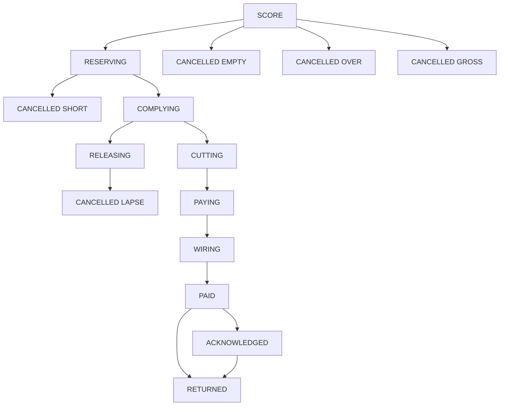
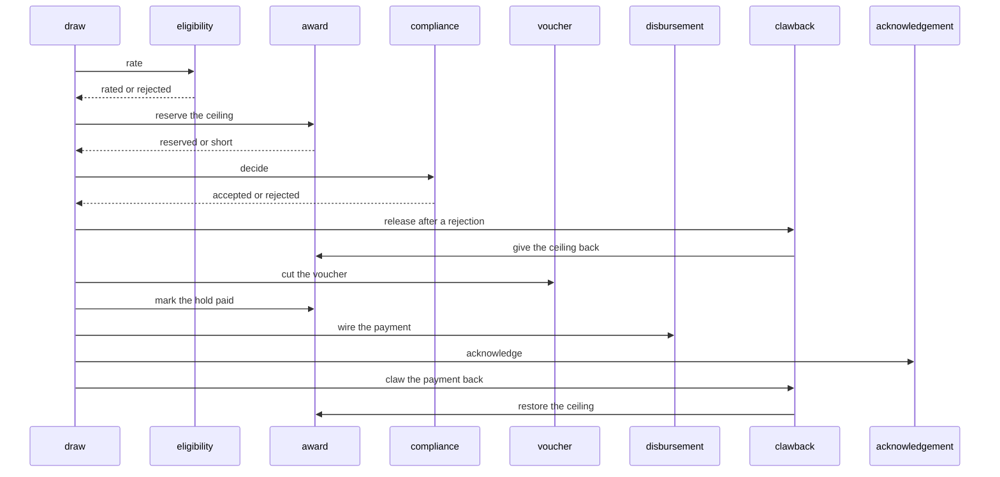

# Grant Desk

An award has a ceiling. A draw is rated from its units and the award's unit price. The award service keeps that amount on the ceiling, or leaves the ceiling alone when the draw is already short. A grantee whose code contains `lapse` is rejected after the ceiling is kept, and a release gives it back. A clawback after payment gives the ceiling back as well. It does not roll the payment back.

Thirteen services each own one Postgres database. The draw service is the saga orchestrator. It does not call the others over HTTP. A step commits its own row and an outbox message in one local transaction. A relay publishes that message. The next service claims an inbox key before it writes.

The award service is the only writer of the open ceiling and of the hold. A reserve subtracts the amount only while the ceiling still covers it. A release or a clawback adds that amount back only while this draw still holds it. Eight units at 125 cents is 1000. Eighty units still rates. One unit past that cancels over, before a ceiling is kept. Zero units cancels empty. A price that overflows the integer range cancels. A draw larger than the open ceiling is short. `unlapsed` matches a lapsed code.





The relay can publish a message and crash before it marks the row sent. The broker then holds a second copy. Consumers dedupe with the inbox key. The saga moves a draw forward only from the status that step expects, so a repeated fact does not apply twice. There is no distributed transaction.

## Services

| Service | Owns | Port |
| --- | --- | --- |
| sponsor-service | the funder | http://localhost:8280 |
| program-service | the grant program | http://localhost:8281 |
| grantee-service | the recipient | http://localhost:8282 |
| milestone-service | the open milestone | http://localhost:8283 |
| award-service | the ceiling and the hold | http://localhost:8284 |
| draw-service | the draw and the saga | http://localhost:8285 |
| eligibility-service | units times the unit price | http://localhost:8286 |
| compliance-service | the lapse decision | http://localhost:8287 |
| voucher-service | the payable voucher | http://localhost:8288 |
| disbursement-service | the outbound wire | http://localhost:8289 |
| acknowledgement-service | the acknowledgement after payment | http://localhost:8290 |
| clawback-service | the release and the clawback | http://localhost:8291 |
| audit-service | one row per fact | http://localhost:8292 |

Postgres is `localhost:5448`. Kafka's host listener is `localhost:9109`. RabbitMQ management is http://localhost:15688.

## Run

```bash
mvn -q -DskipTests package
docker compose up --build -d
./scripts/smoke.sh
docker compose down
```

```bash
curl -s -X POST localhost:8280/sponsors \
  -H 'content-type: application/json' \
  -d '{"sponsorCode":"S-1","name":"North Fund"}'

curl -s -X POST localhost:8281/programs \
  -H 'content-type: application/json' \
  -d '{"programCode":"P-1","status":"OPEN"}'

curl -s -X POST localhost:8282/grantees \
  -H 'content-type: application/json' \
  -d '{"granteeCode":"G-1","name":"Ada"}'

curl -s -X POST localhost:8283/milestones \
  -H 'content-type: application/json' \
  -d '{"milestoneCode":"M-1","programId":"PROGRAM","status":"OPEN"}'

curl -s -X POST localhost:8284/awards \
  -H 'content-type: application/json' \
  -d '{"awardCode":"A-1","sponsorId":"SPONSOR","programId":"PROGRAM","ceilingCents":5000,"unitCents":125}'

curl -s -X POST localhost:8285/draws \
  -H 'content-type: application/json' \
  -d '{"requestId":"draw-1","sponsorId":"SPONSOR","programId":"PROGRAM","granteeId":"GRANTEE","milestoneId":"MILESTONE","awardId":"AWARD","units":8}'
```

The same `requestId` returns the original draw and does not keep the ceiling again.

## Where the same split goes on Azure

This repository runs on Compose. Nothing in it calls a cloud account.

| Compose | Azure |
| --- | --- |
| Postgres 16 | Azure Database for PostgreSQL |
| Kafka 3.8 | Event Hubs |
| RabbitMQ 3.13 | Service Bus queue, with its dead-letter sub-queue |
| the thirteen services | Container Apps or AKS |

## Local credentials

The Compose network is local and unauthenticated. Do not publish these ports.

| | |
| --- | --- |
| Postgres | `platform` / `platform` |
| RabbitMQ | `platform` / `platform`, vhost `/` |
| HTTP | no authentication |

## Tests

`mvn test` checks an empty draw, a draw past 80 units, an integer overflow of units times the unit price, the 1000 cent amount, and a grantee code that contains `lapse`. `./scripts/smoke.sh` pays a draw and acknowledges it, cancels an empty draw, an over draw, and a price overflow without a hold, leaves the ceiling alone when the draw is short, dead-letters a lapsed grantee and gives that ceiling back, claws a paid draw back, and runs two overlapping cases: two draws on one award, and an acknowledgement racing a clawback.

## Same shape, different domain

- [Live Lobby](https://github.com/joshbarros/java-live-lobby)
- [Loyalty Ledger](https://github.com/joshbarros/java-loyalty-ledger)
- [Claims Desk](https://github.com/joshbarros/java-claims-desk)
- [Checkout Counter](https://github.com/joshbarros/java-checkout-counter)
- [Study Hall](https://github.com/joshbarros/java-study-hall)
- [Clearing Desk](https://github.com/joshbarros/java-clearing-desk)
- [Thread Hall](https://github.com/joshbarros/java-thread-hall)
- [Yard Gate](https://github.com/joshbarros/java-yard-gate)
- [House Account](https://github.com/joshbarros/java-house-account)
- [Procure to Pay](https://github.com/joshbarros/java-procure-to-pay)
- [Policy Bind](https://github.com/joshbarros/java-policy-bind)
- [Plant Order](https://github.com/joshbarros/java-plant-order)
- [Meter to Cash](https://github.com/joshbarros/java-meter-to-cash)
- [Carrier Desk](https://github.com/joshbarros/java-carrier-desk)
- [Payroll Desk](https://github.com/joshbarros/java-payroll-desk)
